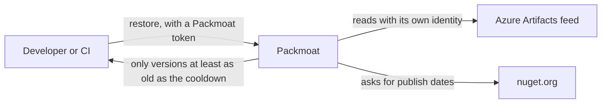

# Packmoat

Packmoat is a package firewall for NuGet.

A brand-new package version is the riskiest one. A hijacked maintainer account or a poisoned release is usually found and pulled within days, but a build that restores it in those first days is already compromised.

Packmoat sits between your NuGet clients and your organisation's Azure Artifacts feed. It hides every version that has been public for less than a **cooldown** (14 days by default), so a restore quietly picks the newest version that is old enough. It also hides public packages whose names start with your **internal prefixes**, so nobody can slip in a public package that pretends to be one of yours (dependency confusion).



## Features

- **Cooldown** per organisation, with a different number of days for single packages if you need it.
- **Internal prefixes**: public packages that look like yours are never served.
- **Waivers**: let one exact version through early, for a limited time.
- **Fails closed**: if a publish date is unknown or a check fails, the version is hidden, never served.
- **Tokens** per organisation, stored only as hashes, and revocable at any time.
- **Audit trail** of every package download, and a record of what was hidden and why.
- **Many organisations** on one server, each with its own feed, settings, tokens and audit trail.
- Optional **admin site** for the operator and **customer site** for each organisation, both with Microsoft sign-in.

Packmoat only serves restores. It does not search or publish packages.

## Ways to run it

| How | Status |
|---|---|
| One server with Docker | Supported |
| Behind your own HTTPS proxy or load balancer | Supported |
| Kubernetes, with the Helm chart | Supported. The chart is not published to a chart repository yet. |
| Azure Container Apps | Supported (pre-production), more than one copy on PostgreSQL (SQLite runs one); tested in CI against PostgreSQL 17. It needs a PostgreSQL database: see [docs/deploy/azure-container-apps.md](docs/deploy/azure-container-apps.md). |

[docs/deploy/README.md](docs/deploy/README.md) lists what every deployment needs, and links to a guide for each way.

If you would rather not run Packmoat yourself, a hosted service is available at https://packmoat.com.

## Learn more

- [docs/concepts.md](docs/concepts.md): organisations, cooldowns, waivers and tokens, in plain words.
- [docs/architecture.md](docs/architecture.md): how the parts fit together.
- [spec/README.md](spec/README.md): the exact behaviour, with shared test cases.

## Status

Packmoat supports NuGet today. Until version 1.0, settings and the interfaces for modules may change in any release. Only the latest `main` branch receives fixes.

To build and test the code you need the .NET SDK named in [dotnet/global.json](dotnet/global.json):

```
cd dotnet
dotnet test
```

## Licence

Packmoat is licensed under the Apache License, Version 2.0. See [LICENSE](LICENSE) and [NOTICE](NOTICE).

## Contributing

Contributions are welcome. Read [CONTRIBUTING.md](CONTRIBUTING.md) first: every commit needs a DCO sign-off. Everyone taking part follows the [code of conduct](CODE_OF_CONDUCT.md).

## Security

Do not report a vulnerability in a public issue. [SECURITY.md](SECURITY.md) says how to report one privately.
