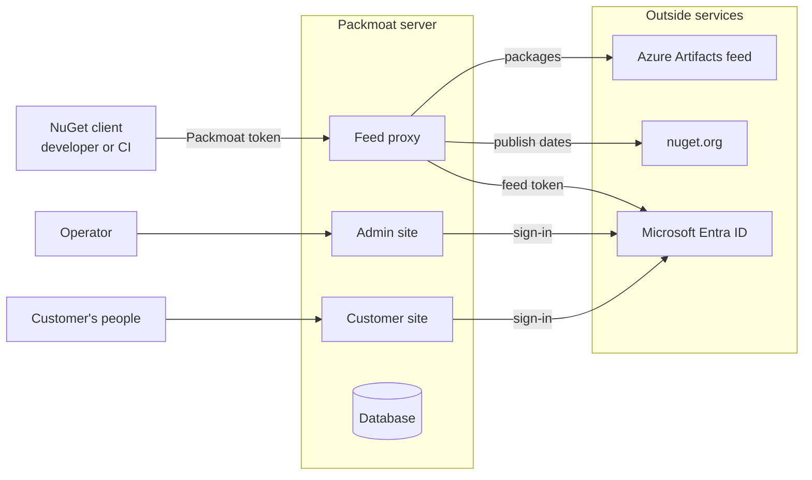
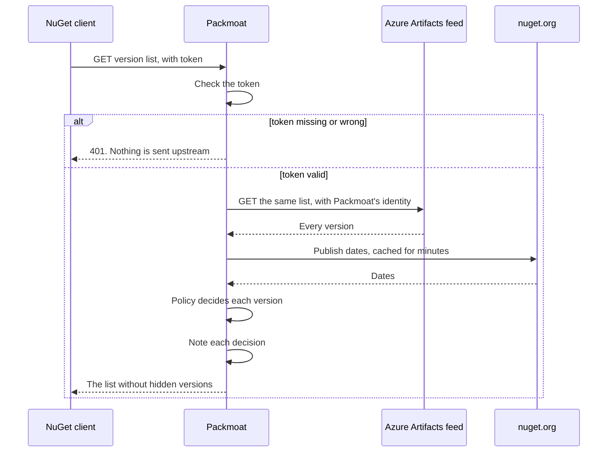
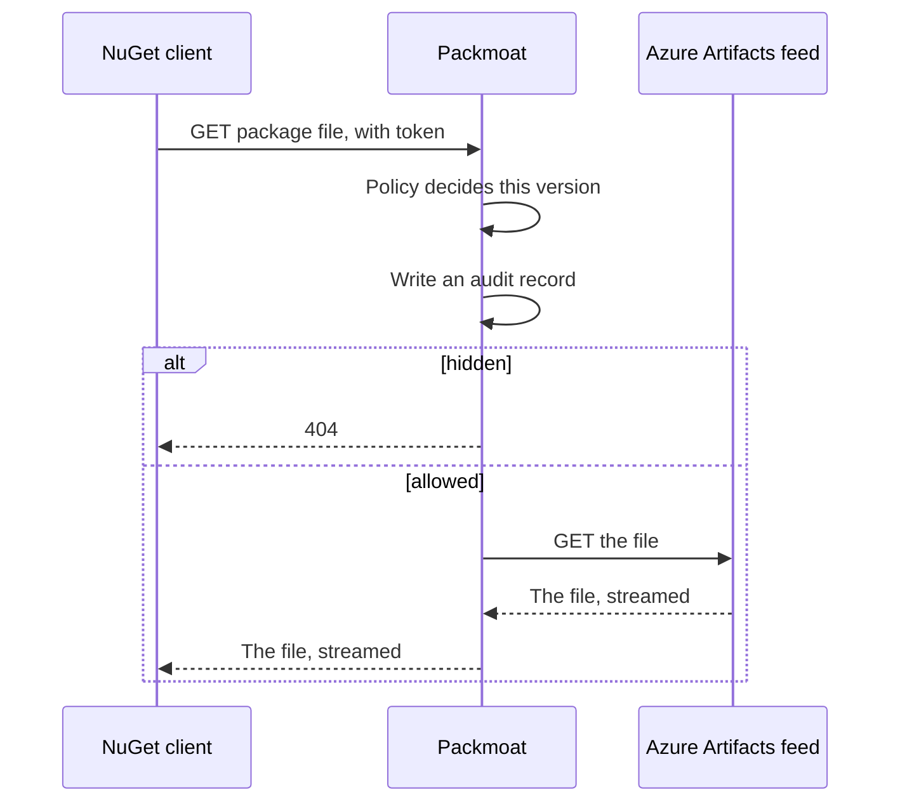
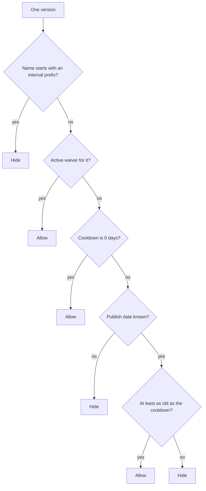
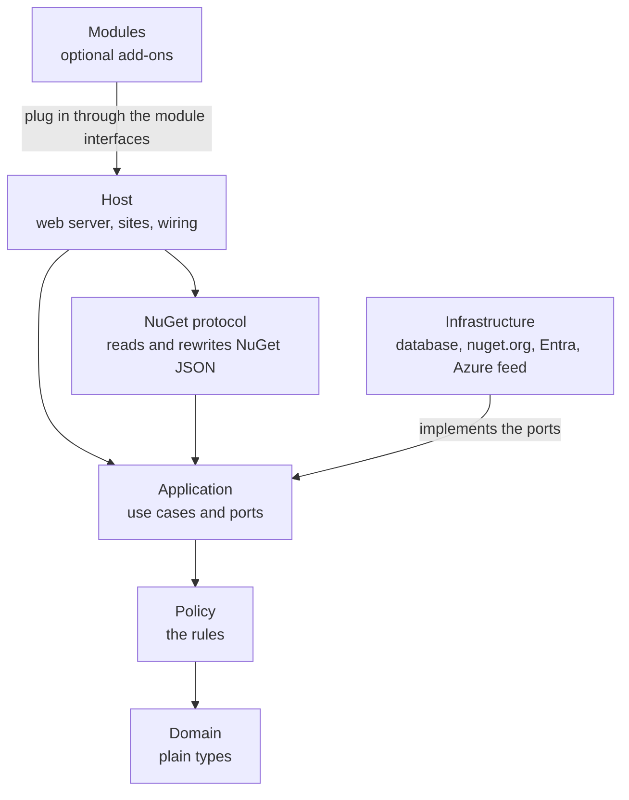
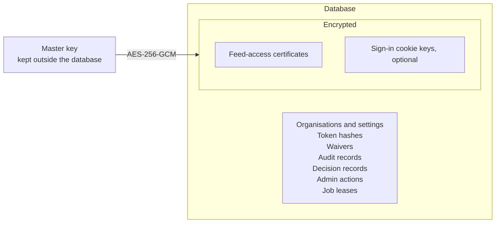
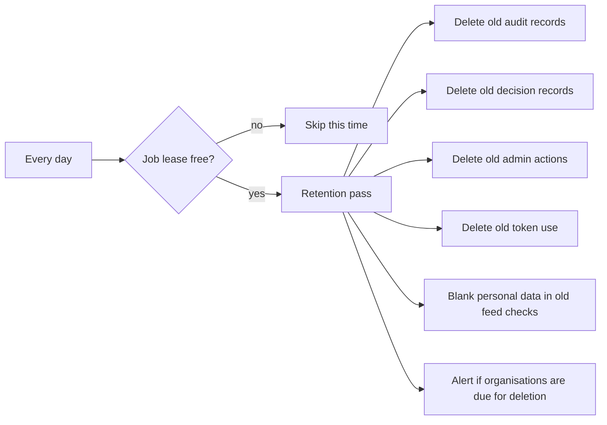

# How Packmoat works

This page shows the parts of Packmoat and how they fit together. For the words used here (organisation, cooldown, waiver, internal prefix), see [concepts.md](concepts.md). For how to run it, see [deploy/README.md](deploy/README.md).

## 1. The big picture

- **Feed proxy**: what NuGet clients talk to. One server serves many organisations.
- **Azure Artifacts feed**: each organisation's own feed. It holds packages from nuget.org. Packmoat reads it with its own Microsoft identity, never with the developer's.
- **nuget.org**: the only trusted source of publish dates. The feed's own dates are when the feed saved a package, which says nothing about its age.
- **Admin site** (optional): for whoever runs the server. Organisations, tokens, waivers, audit.
- **Customer site** (optional): for each organisation. Its people make tokens, add waivers and connect their feed.
- **Microsoft Entra ID**: signs people in to both sites, and gives Packmoat its tokens for the feeds.
- The operator also has a command-line tool, `packmoat-admin`, for setup, tokens, waivers and backups.

Each part answers on its own host name. The feed proxy never reads a sign-in cookie, and the sites never accept a Packmoat token.

## 2. One NuGet request

A version list (or package listing) goes like this:

A package download is decided **before** anything is fetched:

How the policy decides one version. The first rule that answers wins:

If a rule fails, the version is hidden. NuGet then quietly picks the newest allowed version. A project that pins an exact hidden version gets an error instead.

## 3. The main parts and the plug-in points

- **Policy** and **Domain** are plain code: no network, no database, no web framework. They are tested with a fake clock.
- **Application** declares **ports**: interfaces that the outside world implements. A test enforces that the inner parts reference no web, database or cloud packages.
- **Infrastructure** implements the ports. Swap one implementation and nothing else changes.

The main ports:

| Port | What it hides | Today |
|---|---|---|
| Tenant store, token service | Where organisations, tokens and waivers live | SQLite |
| Publish-date source | Where publish dates come from | nuget.org, with a cache |
| Upstream credential source | How Packmoat signs in to a feed | Microsoft Entra certificate |
| Audit log, decision record log | Where records go | SQLite |
| Job lease | Which copy runs a scheduled job | SQLite |
| Serving gate | Which organisations are served | Serve everyone |

**Modules** add what is not the core proxy: extra services, a site on its own host name, pages on the admin or customer site, commands for `packmoat-admin`, and their own database tables. The core with no modules is a complete proxy. The module interfaces may change in any release before 1.0.

## 4. Data

What is stored:

| Data | What it is | Kept for |
|---|---|---|
| Organisations | Feed address, cooldown, per-package cooldowns, internal prefixes | Until the operator deletes the organisation |
| Tokens | A hash only. The token itself is shown once | Until the organisation is deleted |
| Token use | Which token was used on which day | 365 days |
| Waivers | Package, version, reason, who added it, when it ends | Until the organisation is deleted |
| Audit records | Every download: time, package, version, decision, reason, token id | 90 days |
| Decision records | What was decided for each version, and why | 365 days after last seen |
| Admin actions | Changes made by operators and customer admins | 365 days |
| Feed-access identities | The certificates Packmoat uses to read feeds, encrypted | Until replaced or the organisation is deleted |
| Cookie keys | The keys that protect sign-in cookies, encrypted, if kept in the database | Not deleted by Packmoat |
| Job leases | Which copy may run a scheduled job, and until when | One row per job |

How secrets are protected:

- One **master key** (256 bits) encrypts every stored secret with AES-256-GCM.
- Each secret is bound to what it belongs to: copied onto another organisation's row, it will not decrypt.
- The master key is never in the database. Packmoat refuses to start with the wrong key.
- Tokens are not encrypted: only a SHA-256 hash is kept, so a stolen database holds no usable token.

## 5. Security model

- **Two separate credentials.** The developer's token stops at Packmoat. Packmoat calls the feed with its own identity, and never passes that to the client.
- **Redirects carry no credential.** When the feed redirects a download to storage, Packmoat follows it without any credential, and never from HTTPS to HTTP.
- **Fail closed.** An unknown publish date or a failing rule hides the version. If nuget.org cannot answer and no recent cached answer exists, clients get 503 and retry later. An unknown request gets 404.
- **Own feed only.** A request can only reach paths under its organisation's own feed. Other paths and other hosts are refused.
- **Read only.** Packmoat's feed answers GET requests only.
- **Tokens.** Random, stored as a hash, revocable. A revoked token stops working within seconds.
- **Rate limits.** Per token, and per address for wrong tokens, so guessing is slow.
- **Sign-in.** Both sites use Microsoft Entra ID. The admin site admits only an explicit list of people. The customer site admits only people from a directory the operator linked to that organisation.
- **Known host names only.** Packmoat answers only the host names it is configured for. It trusts forwarded client addresses only from proxies you name.
- **Never logged.** Tokens, Authorization headers and certificates.

## 6. Background jobs

- The **retention pass** runs a few minutes after start, then daily. It only deletes what is past its keep time. It never deletes an organisation: that is always the operator's command.
- The pass first takes a **job lease** in the database, so two copies of the server never run it at the same time.
- It can be turned off, and run instead from a scheduler with `packmoat-admin jobs run retention`.
- Audit records and decision records are written in the background, in batches. A slow or failing database loses records, never a download.
