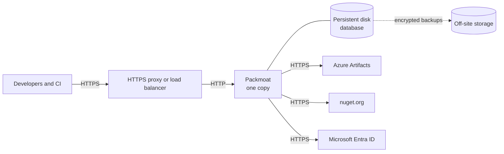

# Running Packmoat

Packmoat is one server program, shipped as one container image. This page lists what every deployment needs, whatever it runs on. Then pick a guide for your setup.

## What every deployment needs

- **HTTPS in front.** Packmoat itself speaks plain HTTP. Something you run must handle HTTPS and pass requests on: a reverse proxy, an ingress controller or a cloud load balancer. It must keep the original host name.
- **One running copy on SQLite; more on PostgreSQL.** By default the database is a single SQLite file, and only one copy of the server may write to it. The server holds a lock on a file beside the database (its name with `.instance` added, such as `packmoat.db.instance`; made owner-only, and safe to leave there): a second server on the same database waits up to 60 seconds for the first to stop, as when a container is recreated, then refuses to start. `packmoat-admin` commands and backups take no lock, and run beside the server. With a PostgreSQL database, more than one copy can run: see [More than one copy of the server](../self-hosting.md#more-than-one-copy-of-the-server).
- **Persistent storage.** The SQLite database must live on a disk that survives restarts and upgrades. A container's own file system is not enough, and neither is a network file share. Where there is no such disk, use PostgreSQL instead: see [PostgreSQL](../self-hosting.md#postgresql).
- **A master key, kept secret.** One random key encrypts the credentials Packmoat stores. Make it once with `packmoat-admin keygen`. Keep it out of the database, out of your backups and out of source control, and keep a copy offline. Without it, a backup cannot be used. It cannot be changed yet, so do not lose it.
- **Microsoft Entra ID apps.** Up to three app registrations in your own directory: one that Packmoat uses to read your customers' feeds, and one each for the admin site and the customer site if you use them.
- **Backups.** A regular, encrypted copy of the database, kept off the machine, with a restore you have practised. With SQLite, `packmoat-admin backup` makes a consistent copy while the server runs. With PostgreSQL, use `pg_dump` or your provider's point-in-time restore.
- **Outbound access** to Azure Artifacts, nuget.org and Microsoft Entra ID.
- **Health checks.** `/healthz` says the server is running. `/readyz` says it can serve: the database opens and the master key matches it.

## The settings that depend on your setup

Packmoat is configured with environment variables. Each one can instead be read from a file, by adding `_FILE` to its name, for example `PACKMOAT_MASTER_KEY_FILE`. Use that for secrets.

| Setting | What it does |
|---|---|
| `PACKMOAT_MASTER_KEY` | The master key. Required. |
| `PACKMOAT_DB` | Where the database file is. Required. Put it on the persistent disk. The image sets it to `/data/packmoat.db`. With `PACKMOAT_DB_ENGINE=postgres`, a PostgreSQL connection string instead. |
| `PACKMOAT_HOSTS` | The feed's host names. Required. Packmoat answers only these, its sites' own names and `localhost`. |
| `PORT` | Unset: the image listens on `127.0.0.1:8080`, reachable only from the same machine. Set: it listens on that port on every address. Set it when the proxy reaches Packmoat over a network: from another machine, or from another container. |
| `PACKMOAT_TRUSTED_PROXIES` | The addresses of your proxy, if it reaches Packmoat over a network (from another machine or another container). Only these may tell Packmoat the client's real address. Never `0.0.0.0/0`; Packmoat refuses it. |
| `PACKMOAT_PUBLIC_BASE_URL` | The feed's public address, only if your proxy hides the original host name. |

The full list of settings is in the [operations guide](../operations.md#settings).

## Ways to run it

| Guide | When to use it | Status |
|---|---|---|
| [Single server](single-server.md) | One Linux server with Docker. Includes a ready-made HTTPS proxy and backups. | Supported |
| [Your own proxy](own-proxy.md) | You already have HTTPS in front: nginx, a cloud load balancer or similar. | Supported |
| [Kubernetes](kubernetes.md) | A cluster, with the Helm chart. | Supported. The chart is not published to a chart repository yet. |
| [Azure Container Apps](azure-container-apps.md) | A managed container platform on Azure. | Supported (pre-production), more than one copy on PostgreSQL (SQLite runs one); tested in CI against PostgreSQL 17. It needs a PostgreSQL database. A Bicep template (`deploy/azure-container-apps`): template checked offline in CI; not yet deployed by the project. |

If you would rather not run Packmoat yourself, a hosted service is available at https://packmoat.com.
